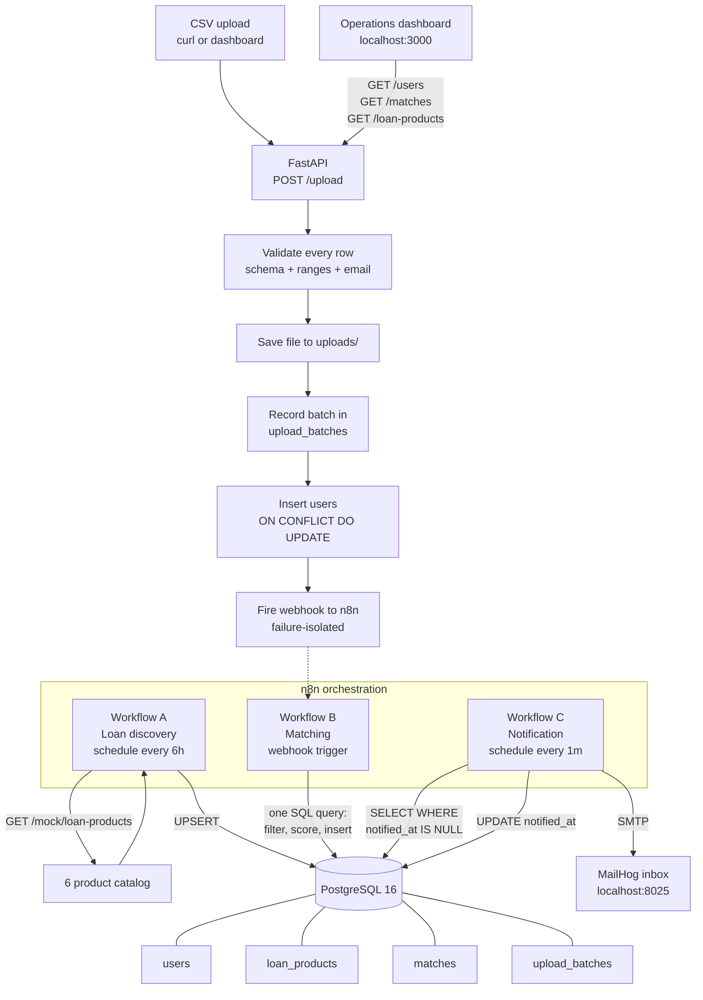

# Architecture

## The pipeline



## Docker services

| Container | Image | Port | Job |
|---|---|---|---|
| `loan-postgres` | postgres:16 | 5432 | All application state |
| `loan-backend` | python:3.12-slim | 8000 | FastAPI, CSV validation, webhook |
| `loan-n8n` | n8nio/n8n | 5678 | Workflow orchestration |
| `loan-mailhog` | mailhog/mailhog | 1025, 8025 | SMTP sink + inbox UI |
| `loan-frontend` | nginx:alpine | 3000 | Static dashboard |

## The database

Four tables. Each one has a job:

**`upload_batches`** — one row per CSV upload. Status, counts, timestamps.  
Every user row links back to the batch that brought it in. This is the audit  
trail.

**`users`** — applicant records. `user_id` is the business key, `id` is the  
surrogate. On conflict, updates rather than duplicates.

**`loan_products`** — the catalog. Eligibility thresholds plus a `source_url`  
for provenance. Upserted by Workflow A so re-runs don't duplicate.

**`matches`** — user × product pairs that passed the pre-filter. Score,  
reason, and a nullable `notified_at` that makes notification idempotent.

## The matching query

One statement. This is the whole matching engine.

```sql
WITH candidates AS (
   SELECT u.user_id, u.monthly_income, u.credit_score, u.age,
          l.id AS product_id, l.min_monthly_income,
          l.min_credit_score, l.min_age, l.max_age
     FROM users u
     CROSS JOIN loan_products l
    WHERE u.upload_batch_id = $1::uuid
      AND u.monthly_income >= l.min_monthly_income
      AND u.credit_score   >= l.min_credit_score
      AND u.age            BETWEEN l.min_age AND l.max_age
      AND (l.employment_statuses IS NULL
           OR u.employment_status = ANY(l.employment_statuses))
),
scored AS (
   SELECT user_id, product_id,
          ROUND(
              0.50 * LEAST(1.0, (credit_score - min_credit_score)::numeric / 200.0)
            + 0.30 * LEAST(1.0, (monthly_income - min_monthly_income)::numeric
                                / NULLIF(min_monthly_income, 0))
            + 0.20 * (1.0 - ABS(age - ((min_age + max_age) / 2.0))
                            / NULLIF((max_age - min_age) / 2.0, 0)),
              2
          ) * 100 AS match_score,
          'income>=' || min_monthly_income
              || ', credit>=' || min_credit_score
              || ', age ' || min_age || '-' || max_age AS match_reason
     FROM candidates
)
INSERT INTO matches (user_id, product_id, match_score, match_reason)
SELECT user_id, product_id, match_score, match_reason FROM scored
ON CONFLICT (user_id, product_id) DO UPDATE
  SET match_score  = EXCLUDED.match_score,
      match_reason = EXCLUDED.match_reason
RETURNING user_id, product_id, match_score;
```

The `CROSS JOIN` and the four `WHERE` predicates are the pre-filter. The  
`scored` CTE is the deterministic scoring. The `ON CONFLICT DO UPDATE` makes  
re-runs safe.

Two indexes make it fast:

```sql
CREATE INDEX idx_users_eligibility
 ON users(monthly_income, credit_score, age, employment_status);

CREATE INDEX idx_loan_products_eligibility
 ON loan_products(min_monthly_income, min_credit_score, min_age, max_age);
```

## Failure isolation

The FastAPI `/upload` handler does this in order:

1. Validate and insert users (committed to Postgres)
2. Update `upload_batches.status = 'completed'`
3. Fire the webhook to n8n (with a 10-second timeout)

Step 3 is wrapped in a try/except that logs failures but doesn't roll back.  
If n8n is down, the batch is still recorded and traceable. Matching can be  
re-triggered later via `POST /dev/rematch/{batch_id}`.

This is why the ingestion pipeline doesn't depend on the orchestrator's  
uptime. S3 → Lambda → n8n has the same property in AWS.

## Local → AWS

See `infrastructure/serverless.yml` for the full config. The service  
boundaries are identical; only the transport changes:

- CSV body via `POST /upload` → presigned S3 PUT URL
- Docker volume for uploaded files → S3 bucket
- Lambda invoked by S3 event → Lambda invoked by HTTP request

Everything downstream — schema, matching SQL, n8n workflows, dashboard —  
is unchanged.
